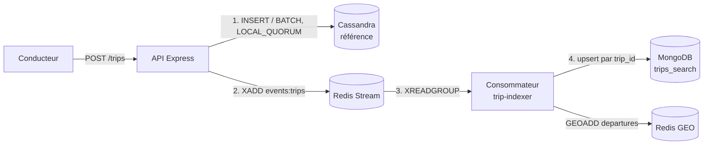
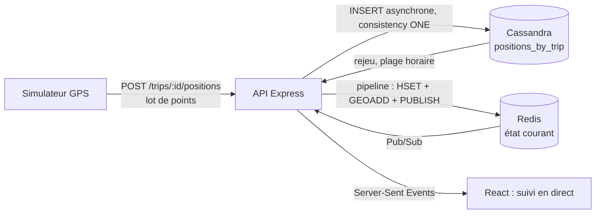

# Analyse des bases de données

Dossier d'architecture des données, rédigé par l'Architecte NoSQL. Il s'appuie sur le sujet G8 (synthèse, cahier des
charges), le guide commun des projets, le TD Sujet 02 et les cours R5.10 (modélisation, indexation, cohérence,
distribution, systèmes polyglottes, Redis).

> **Statut : architecture validée par l'enseignant le 27/11/2026 : Cassandra + Redis + MongoDB** (section 6).
> La décision et la grille sont reportées dans [bdd-secondaire.md](bdd-secondaire.md).

---

## 1. Ce que le sujet impose

| Élément | Contenu | Conséquence pour les bases |
|---|---|---|
| Base principale | Cassandra, imposée | Écritures massives, historique volumineux, modélisation « une table par requête » |
| Seconde base | Libre, **justifiée** selon 7 critères : volumétrie, performance, temps réel, modèle de données, cohérence, disponibilité, complexité des requêtes | 2 pts au barème |
| Fonction avancée obligatoire | Géolocalisation simulée : position actuelle, progression du trajet, historique et rejeu | Le besoin le plus exigeant en temps réel |
| Échelle | Nationale, plusieurs centaines de milliers de comptes, « des milliers de mises à jour de position par minute » | Distribution, partitionnement, pics d'activité |
| Barème | Modélisation NoSQL 5 pts, requêtes complexes 3 pts | Chaque base doit porter des requêtes non triviales et démontrables |
| Pistes proposées par le sujet | Redis (suivi temps réel), MongoDB (profils utilisateurs), Neo4j (relations conducteurs / passagers) | Les trois candidats évalués ci-dessous |

Rappel du cours « Architectures réelles » : on justifie un choix par une **contrainte technique précise**, et on
nomme le compromis CAP accepté.

---

## 2. Analyse des données

| Catégorie | Exemples | Volume | Fréquence | Criticité | Cohérence attendue |
|---|---|---|---|---|---|
| Utilisateurs | compte, rôle, mot de passe haché, profil | Centaines de milliers | Lecture fréquente, écriture rare | Haute (authentification) | Forte à l'écriture |
| Trajets | départ, arrivée, date, prix, places | Millions sur la durée | Création et consultation permanentes | Haute | Forte sur les places restantes |
| Réservations | passager, trajet, nombre de places, statut | Millions | Pics (vacances, vendredis soir) | **Critique** : pas de surréservation | **Forte** |
| Évaluations | note, commentaire, auteur, cible | Croissance continue, conservées longtemps | Écriture après trajet, lecture fréquente | Moyenne | À terme (éventuelle) |
| Positions GPS (historique) | lat, lon, vitesse, horodatage | **Très gros** : 1 point toutes les N secondes par véhicule actif | Écriture continue | Faible unitairement | À terme ; une position perdue est sans gravité |
| Position courante | dernière position de chaque trajet en cours | Petit : 1 entrée par trajet actif | Écrasée en continu, lue en continu | Moyenne (affichage en direct) | À terme, latence minimale |
| Relations | qui a voyagé avec qui, qui a noté qui | Croît avec les réservations | Lecture occasionnelle | Faible | À terme |

**Données géographiques :** villes de départ et d'arrivée (coordonnées des communes), trace GPS des trajets, position
courante. **Données critiques :** réservations et places restantes, puis comptes utilisateurs.

---

## 3. Ce que Cassandra couvre bien… et moins bien

Cassandra est **AP** avec une cohérence réglable par requête (`ONE`, `LOCAL_QUORUM`, `QUORUM`) : idéal pour
l'ingestion continue et les historiques volumineux, ce que le sujet met en avant.

| Besoin | Cassandra | Commentaire |
|---|---|---|
| Historique des positions et rejeu | ✅ Excellent | `positions_by_trip`, partition `(trip_id, day)`, clustering `ts` : lecture par plage native |
| Trajets, réservations, utilisateurs, avis | ✅ Bon | Une table par requête, dénormalisation assumée |
| Places restantes sans surréservation | ✅ Possible | Transaction légère `IF seats_left >= ?` (Paxos) en `LOCAL_QUORUM` : coûteuse mais rare |
| Recherche départ / arrivée / date | ✅ Bon | Partition `(origin_city, destination_city, day)` |
| Filtres secondaires (prix max, note min, places) | ⚠️ Moyen | Pas de filtre hors clé sans `ALLOW FILTERING` (anti-pattern du cours) ; filtrage côté API sur une partition bornée, ou index SAI de Cassandra 5 à valider |
| Recherche par proximité (« départs à moins de 10 km ») | ❌ Faible | Aucun index géospatial natif |
| Position courante en direct | ⚠️ Moyen | Lisible (`LIMIT 1` sur la partition du jour), mais aucune notification : le front doit interroger en boucle |
| Données éphémères (tentatives de connexion, jetons révoqués, cache) | ⚠️ Moyen | TTL disponible, mais pas fait pour des compteurs volatils très sollicités |
| Parcours de relations (amis d'amis, confiance) | ❌ Faible | Aucune jointure ni traversée |

Les bases secondaires doivent donc couvrir les points ❌ ou ⚠️, **sans dupliquer** ce que Cassandra fait déjà bien.

---

## 4. Les trois candidats

### Redis : clé-valeur en mémoire, « suivi temps réel »

Ce qu'il porterait (structures choisies selon la requête, comme l'exige le cours) :

| Besoin | Structure | Exemple |
|---|---|---|
| Position courante d'un trajet | `HASH` + `EXPIRE` | `HSET trip:42:pos lat 45.83 lon 1.26 ts … progress 0.37` |
| Véhicules en circulation, requête de rayon | `GEO` | `GEOADD trips:live 1.26 45.83 trip:42`, `GEOSEARCH … BYRADIUS 5 km` |
| Diffusion en direct au front | Pub/Sub ou `STREAM` | `XADD trip:42:events MAXLEN ~ 500 * lat … lon …` |
| Départs proches d'un point | `GEO` | `departures:2026-12-18` alimenté à la création d'un trajet |
| Limiter les tentatives de connexion (exigence sécurité) | `STRING` + `INCR` + `EXPIRE` | `login:attempts:<ip>` |
| Jetons révoqués avant expiration | `STRING` avec `EX` | `jwt:revoked:<jti>` |
| Cache de recherche | `STRING` (JSON) avec `EX` | `search:<hash des critères>` 60 s |
| Classement des conducteurs | `ZSET` | `ZADD drivers:rating 4.8 user:7` |

- **Atouts :** latence sous la milliseconde, TTL natif, `GEO` et Pub/Sub adaptés à la fonction avancée obligatoire,
  aucune concurrence avec Cassandra (il ne porte que des données dérivées ou éphémères).
- **Limites :** tout en RAM, donc il ne stocke jamais l'historique ; réplication asynchrone, donc quelques écritures
  perdues possibles lors d'une bascule ; requêtes limitées à l'accès par clé ou par structure.
- **CAP :** plutôt AP (réplication asynchrone, Sentinel pour la bascule, Redis Cluster pour le sharding).

### MongoDB : document, « profils utilisateurs » ou recherche

- **Ce qu'il porterait :** soit des profils riches (véhicule, préférences : animaux, musique, fumeur), soit une copie
  des trajets dédiée à la recherche et aux statistiques (index composés, `2dsphere`, pipeline d'agrégation).
- **Atouts :** modèle souple, index secondaires et géospatiaux, agrégations : très bon pour les « requêtes
  complexes ».
- **Limites :** s'il devient la référence d'une partie des utilisateurs ou des trajets, il chevauche Cassandra : deux
  sources de vérité, donc une double écriture que le cours qualifie d'**anti-pattern** sans bus d'événements. Temps
  réel limité aux *change streams*.
- **CAP :** CP par défaut (un primaire par replica set, élection en cas de panne : brève indisponibilité en écriture).

### Neo4j : graphe, « relations conducteurs / passagers »

- **Ce qu'il porterait :** graphe `(:User)-[:A_VOYAGE_AVEC]->(:User)`, `(:User)-[:A_NOTE {note}]->(:User)` pour des
  recommandations (« conducteurs notés 5★ par des passagers avec qui j'ai voyagé ») ou de la détection de faux avis.
- **Atouts :** traversées en coût quasi constant (*index-free adjacency*), requêtes Cypher spectaculaires.
- **Limites :** aucune fonctionnalité obligatoire ne l'exige, il faudrait en inventer une. Inadapté au temps réel. Le
  clustering n'existe qu'en édition Enterprise, donc la disponibilité en Community est limitée à un seul nœud.
- **CAP :** CP (transactions ACID).

---

## 5. Grille de justification

Notes de 1 à 5 : **adéquation au besoin que la base porterait dans BlaBlaNoSQL**, et non qualité absolue de l'outil.

| Critère | Redis | MongoDB | Neo4j | Justification |
|---|:-:|:-:|:-:|---|
| Volumétrie | 4 | 4 | 3 | Redis ne garde que l'état courant (1 entrée par trajet actif, quelques Mo) ; MongoDB tient le disque ; Neo4j suit la croissance des relations |
| Performance | 5 | 4 | 3 | RAM et O(1) / O(log N) contre accès disque ; Neo4j rapide en lecture de graphe, pas en écriture massive |
| Temps réel | 5 | 3 | 1 | Pub/Sub, Streams, TTL, `GEO` contre *change streams* ; rien pour Neo4j |
| Modèle de données | 4 | 4 | 3 | `HASH` / `GEO` / `ZSET` collent à la géolocalisation ; documents pour les profils ; graphe pour une fonction non demandée |
| Cohérence | 4 | 4 | 4 | Positions tolérantes à un léger retard ; `w: majority` ; ACID |
| Disponibilité | 4 | 4 | 2 | Sentinel / Cluster ; replica set (élection) ; Community = un seul nœud |
| Complexité des requêtes | 3 | 5 | 5 | Accès par clé et `GEOSEARCH` contre agrégations ou traversées |
| **Total** | **29** | **28** | **21** | |

Redis et MongoDB sont au coude-à-coude, mais sur des critères opposés : Redis gagne sur le temps réel et la
performance, MongoDB sur la complexité des requêtes. Ils ne répondent pas au même besoin, d'où le choix de les
retenir tous les deux, chacun sur son domaine (section 6). Neo4j est écarté : aucune fonctionnalité demandée ne
l'exige.

---

## 6. Architecture retenue : Cassandra + Redis + MongoDB

Persistance polyglotte, comme le cas Strava du cours : **chaque base porte le besoin pour lequel elle est la meilleure,
et une seule est la référence.**

| Base | Rôle | Données | Référence ? |
|---|---|---|---|
| **Cassandra** | Écritures métier et historique | Utilisateurs, trajets, réservations, avis, historique GPS | **Oui**, pour toutes les données métier |
| **Redis** | Temps réel, cache, sécurité, bus d'événements | Position courante, véhicules en circulation, cache, tentatives de connexion, jetons révoqués, Streams d'événements | Non : tout se reconstruit depuis Cassandra |
| **MongoDB** | Lecture et analyse | Copie des trajets enrichie pour la recherche multicritère et géographique, statistiques | Non : copie alimentée par les événements |

### Pourquoi trois bases

1. **Cassandra** est imposée et excelle pour les écritures massives et l'historique, mais elle ne sait ni filtrer hors
   de sa clé, ni chercher par proximité, ni prévenir le front d'un changement (section 3).
2. **Redis** couvre la **fonction avancée obligatoire** (position actuelle, progression, suivi en direct) et absorbe la
   charge de lecture : sans lui, chaque personne qui suit un trajet interroge Cassandra en boucle (section 8). Il
   renforce aussi la sécurité (limitation des connexions, révocation de jetons) et sert de bus d'événements.
3. **MongoDB** couvre la **recherche multicritère** demandée par le sujet (prix, places, note, rayon autour d'un point,
   tri) et les **statistiques**, que Cassandra ne peut servir sans `ALLOW FILTERING` ni une table par combinaison de
   filtres. Ce sont les requêtes les plus riches du projet (3 pts « requêtes complexes »).

**Règle d'or :** aucun objet n'est coupé entre deux bases. Un trajet, un utilisateur ou une réservation est écrit
**uniquement** dans Cassandra ; Redis et MongoDB n'en contiennent que des copies ou des états dérivés.

### Flux d'écriture d'un trajet (synchronisation par événements)



- L'événement n'est publié **qu'après** la réussite de l'écriture Cassandra : la référence est toujours à jour.
- Le consommateur fait un *upsert* par `trip_id` : rejouer un événement ne crée pas de doublon (**idempotence**,
  bonne pratique du cours sur la cohérence).
- Les messages non acquittés (`XPENDING`) sont retraités au redémarrage du consommateur.
- Si l'API plante entre l'étape 1 et l'étape 2, l'événement est perdu : un script `scripts/reindex-mongo` reconstruit
  MongoDB depuis Cassandra (lancé au démarrage et à la demande). Ce choix évite un mécanisme de type *outbox*, trop
  lourd pour 16 h ; il est documenté comme compromis.
- Événements émis : `trip.created`, `trip.updated`, `trip.deleted`, `booking.created`, `booking.cancelled` (mise à
  jour de `seats_left` dans la copie), `review.created` (mise à jour de la note du conducteur).

### Flux d'écriture d'une position



MongoDB n'intervient pas : les positions ne passent jamais par lui. Cassandra est écrit en premier, car c'est la
donnée durable. Si l'écriture Redis échoue, la position suivante (quelques secondes plus tard) corrige l'état : la
cohérence est **à terme**, et le coût d'un écart est nul.

### Modèle MongoDB

Une collection principale, `trips_search`, un document par trajet, construit pour les requêtes de recherche
(embedding hybride du cours : copie des données utiles à l'affichage, plus les identifiants de référence).

```json
{
  "_id": "trip uuid (identique à Cassandra)",
  "origin": { "city": "Limoges", "location": { "type": "Point", "coordinates": [1.2611, 45.8336] } },
  "destination": { "city": "Bordeaux", "location": { "type": "Point", "coordinates": [-0.5792, 44.8378] } },
  "departureTime": "2026-12-18T17:30:00Z",
  "price": 18.5,
  "seatsTotal": 3,
  "seatsLeft": 2,
  "status": "planned",
  "driver": { "id": "user uuid", "name": "Camille", "rating": 4.8, "ratingCount": 37 },
  "options": { "pets": false, "smoking": false, "luggage": "medium" },
  "updatedAt": "2026-11-27T10:12:00Z"
}
```

| Index | Requête servie |
|---|---|
| `{ "origin.location": "2dsphere" }` | Départs dans un rayon autour d'un point (`$geoNear`) |
| `{ "origin.city": 1, "destination.city": 1, "departureTime": 1, "price": 1 }` | Recherche par axe et date, filtre et tri sur le prix (champs d'égalité d'abord, puis tri, puis plage : l'ordre de l'index suit la requête) |
| `{ "departureTime": 1, "seatsLeft": 1 }` | Trajets disponibles sur une période |
| `{ "driver.id": 1 }` | Mise à jour de la note dans tous les trajets d'un conducteur |

Requêtes complexes démontrables :

- **Recherche « autour de moi »** : `$geoNear` (rayon 10 km) + filtres prix, places, note minimale, options, tri par
  heure de départ.
- **Axes les plus demandés** : `$group` par `(origin.city, destination.city)`, nombre de trajets, prix moyen, taux de
  remplissage `1 - seatsLeft / seatsTotal`.
- **Statistiques par conducteur** : nombre de trajets, prix moyen, note.

### Ordre de livraison

1. **Cassandra** : tables, seed, API métier. L'application fonctionne déjà seule.
2. **Redis** : position en direct, SSE, cache, sécurité, bus d'événements (nécessaire à la fonction obligatoire).
3. **MongoDB** : consommateur, recherche avancée, statistiques, script de reconstruction.

Si le temps manque, MongoDB est la seule brique qu'on peut retirer sans casser l'application : la recherche retombe
sur la table Cassandra `trips_by_route_date`.

---

## 7. Proposition initiale étudiée : tout Cassandra + MongoDB, Redis en option

Proposition faite dans l'équipe avant la décision :

| Donnée | Base proposée |
|---|---|
| Points GPS, position actuelle, historique rejouable | Cassandra |
| Recherche de trajets (départ, destination, date) | Cassandra |
| Réservations (par trajet et par passager), avec `IF` | Cassandra |
| Évaluations reçues par un utilisateur | Cassandra |
| Profils utilisateurs, véhicules, détails d'un trajet (étapes, options) | MongoDB |
| Redis | En option, s'il reste du temps |

**Points repris tels quels :** les quatre lignes Cassandra correspondent au modèle de [bdd-cassandra.md](bdd-cassandra.md),
et la réservation par transaction légère `IF` est conservée.

**Pourquoi elle n'a pas été retenue telle quelle, l'objectif étant la performance maximale :**

1. **La charge se concentre sur la ligne laissée en option.** Les écritures de positions sont absorbées sans difficulté
   par Cassandra. Le vrai volume vient des **lectures** de la position en direct : chaque passager et chaque personne
   qui suit le trajet interroge le serveur toutes les quelques secondes. Sans Redis, chaque lecture touche Cassandra
   et le front doit interroger en boucle (voir l'estimation de charge en section 8).
2. **« Documents souples » ne démontre pas que Cassandra ne suffit pas.** Cassandra stocke très bien un profil, un
   véhicule (type défini par l'utilisateur, UDT) ou une liste d'étapes (`list<frozen<step>>`). La justification de la
   seconde base (2 pts) doit montrer un besoin que Cassandra couvre mal.
3. **Les objets sont coupés en deux bases.** Un trajet aurait sa partie recherche dans Cassandra et ses détails dans
   MongoDB, et un utilisateur sa partie connexion dans Cassandra et son profil dans MongoDB. Chaque création coûte deux
   écritures, chaque affichage deux lectures sur deux systèmes, et une panne entre les deux écritures laisse les
   données contradictoires : c'est l'anti-pattern de l'écriture multiple vu dans le cours sur les systèmes
   polyglottes.

L'architecture retenue (section 6) garde MongoDB, mais lui confie un besoin que Cassandra ne sait pas couvrir : la
**recherche multicritère et géographique des trajets** et les statistiques, avec Cassandra comme seule référence et
MongoDB comme copie alimentée par les événements. Redis passe d'option à brique obligatoire.

---

## 8. Optimisations

### Estimation de la charge

Hypothèse de dimensionnement, à ajuster avec le jeu de données :

| Grandeur | Hypothèse | Charge |
|---|---|---|
| Trajets en cours au pic | 2 000 | |
| Fréquence d'envoi d'une position | 1 point toutes les 5 s | **400 écritures/s** (24 000/min) |
| Personnes qui suivent un trajet | 4 en moyenne | 8 000 clients connectés |
| Lecture en boucle toutes les 2 s (sans Redis) | | **4 000 lectures/s** sur Cassandra |
| Envoi des mises à jour au front (avec Redis + SSE) | | **0 lecture** : 400 messages/s diffusés |
| Historique produit par jour | 2 000 trajets × 2 h × 720 points/h | ≈ 2,9 millions de lignes, ≈ 300 Mo bruts |

Conclusion : les écritures ne sont pas le goulot d'étranglement, Cassandra en absorbe des dizaines de milliers par
seconde. Le gain principal vient de **supprimer les lectures en boucle** grâce à Redis et à l'envoi des mises à jour au
front.

### Position en direct

- **Envoi au lieu d'interrogation :** l'API garde une connexion Server-Sent Events par client et s'abonne au canal Redis
  `trip:{id}` (Pub/Sub). Une position reçue est diffusée une fois à tous les abonnés, sans aucune lecture en base.
  SSE suffit (flux serveur → client uniquement), passe par HTTP et se reconnecte tout seul ; WebSocket n'apporte rien
  de plus ici.
- **Plusieurs instances de l'API :** Pub/Sub sert aussi de bus entre instances : chaque instance reçoit les positions
  et les relaie à ses propres clients.
- **Un seul aller-retour vers Redis par position :** `HSET` + `EXPIRE` + `GEOADD` + `PUBLISH` envoyés en *pipeline*.
- **Progression calculée une seule fois :** au moment de l'écriture (stockée dans le `HASH`), pas à chaque lecture.
- **Envoi par lots :** le simulateur envoie plusieurs points par requête HTTP pour réduire le nombre de requêtes.

### Cassandra

- **Requêtes préparées** partout et politique de répartition *token-aware* et *DC-aware* du driver (requête envoyée
  directement à un nœud qui possède la donnée, dans le DC local).
- **Écritures de positions asynchrones** (`executeConcurrent`) en `ONE`, sans lecture préalable.
- **`positions_by_trip`** : partition `(trip_id, day)`, tri `ts DESC`, compaction `TimeWindowCompactionStrategy`
  (adaptée aux séries temporelles qu'on ne modifie jamais). Pas de TTL par défaut : le sujet demande une conservation
  durable de l'historique.
- **Tables lues plus qu'écrites** (`trips`, `users`) : compaction `LeveledCompactionStrategy` pour des lectures plus
  rapides.
- **Réservation :** la transaction légère ne porte que sur la ligne du trajet (une partition par trajet, donc
  contention uniquement entre passagers du même trajet). Ensuite, un `BATCH` logué écrit `bookings_by_trip` et
  `bookings_by_user`. Une transaction légère ne pouvant pas être mélangée à un batch multi-partitions, une erreur du
  batch déclenche la libération de la place.
- **Note moyenne sans lecture préalable :** table de compteurs `user_rating (somme, nombre)` incrémentée à chaque avis ;
  la moyenne se calcule à la lecture.
- **Pagination** avec le `pageState` du driver, jamais d'`OFFSET`.

### Redis

- **Cache des résultats de recherche MongoDB** de 30 à 60 s, avec une clé construite à partir des critères
  normalisés ; les places sont revérifiées par la transaction légère au moment de réserver.
- **Streams d'événements** bornés (`XADD … MAXLEN ~ 100000`) et lus en groupe de consommateurs (`XREADGROUP`), pour
  pouvoir lancer plusieurs consommateurs en parallèle.
- **Données reconstructibles :** persistance minimale (`appendfsync everysec` ou aucune) et politique
  `maxmemory-policy volatile-lru` ; toutes les clés éphémères ont un TTL.
- **Hash tags** (`{trip:42}:pos`, `{trip:42}:events`) pour garder les clés d'un même trajet sur le même nœud en cluster.

### MongoDB

- **Hors du chemin critique :** ni les positions ni les réservations ne l'attendent ; il n'est écrit que par le
  consommateur d'événements, à un rythme bien plus faible (créations et modifications de trajets, réservations).
- **Index alignés sur les requêtes** (section 6) et vérifiés avec `explain("executionStats")` : `IXSCAN`, jamais
  `COLLSCAN`. Pas d'index « au cas où », chacun ralentit les écritures.
- **Projection :** ne renvoyer que les champs affichés dans la liste de résultats.
- **Écritures du consommateur** groupées avec `bulkWrite` (`ordered: false`) et en `w: 1` : la copie se reconstruit
  depuis Cassandra, la durabilité maximale n'est pas nécessaire.
- **Lectures** sur le primaire par défaut ; lecture sur les secondaires (`secondaryPreferred`) possible pour les
  statistiques, qui tolèrent un léger retard.

### API

- **JWT sans état :** aucune lecture en base pour authentifier une requête ; seule la révocation est vérifiée dans
  Redis, en O(1).
- **Une seule connexion par base et par instance** (clients créés au démarrage), jamais une connexion par requête.

---

## 9. Compromis CAP par usage (TD, question 5)

| Usage | Choix | Mise en œuvre |
|---|---|---|
| Réservations | **C avant A** | `LOCAL_QUORUM` + LWT sur les places ; mieux vaut refuser une réservation que surréserver |
| Géolocalisation | **A avant C** | Cassandra en `ONE`, Redis asynchrone ; une position en retard de quelques secondes est acceptable |
| Évaluations | A, cohérence à terme | Note moyenne dénormalisée, recalculée de façon asynchrone ; un léger décalage est sans gravité |
| Recherche de trajets | A, cohérence à terme | Copie MongoDB en retard de moins d'une seconde sur Cassandra, cache Redis de 60 s ; les places sont revérifiées au moment de réserver (LWT) |
| Statistiques | A, cohérence à terme | Agrégations MongoDB, éventuellement sur un secondaire ; un retard de quelques secondes est sans gravité |
| Comptes utilisateurs | C à l'écriture | `LOCAL_QUORUM` à l'inscription (unicité de l'email via `users_by_email` + `IF NOT EXISTS`) |

PACELC : hors panne, on privilégie la **latence** (L) partout sauf sur les réservations et les comptes, où l'on
privilégie la **cohérence** (C).

---

## 10. Répartition, pics et pannes (TD, questions 3 et 4)

**Partitionnement Cassandra :**

- `trips_by_route_date` : `(origin_city, destination_city, day)`. Un trajet très demandé (Paris → Lyon le vendredi)
  crée une partition chaude ; si la volumétrie le justifie, ajouter un découpage par tranche horaire.
- `positions_by_trip` : `(trip_id, day)`, ce qui borne la taille des partitions ; pas de TTL, l'historique est conservé.
- Geo-partitioning : un datacenter par grande région (`NetworkTopologyStrategy`, `LOCAL_QUORUM`), chaque DC servant
  ses utilisateurs avec une faible latence.

**MongoDB :** replica set (1 primaire, 2 secondaires) ; sharding possible plus tard par clé hachée sur `_id`, ou par
région de départ pour du geo-sharding.

**Redis :** Redis Cluster, avec des *hash tags* (`{trip:42}:pos`, `{trip:42}:events`) pour garder les clés d'un même
trajet sur le même nœud.

**Pics d'activité :** départs en vacances, week-ends, grèves. Ils frappent les écritures de positions (absorbées par
Cassandra en `ONE`), les recherches (cache Redis) et les réservations (LWT plus lentes : accepter une latence plus
élevée plutôt qu'une incohérence).

**Priorité des données en cas de panne :** réservations > trajets > comptes > évaluations > position courante >
historique des positions.

- Perte d'un nœud Cassandra : `LOCAL_QUORUM` avec RF = 3 tolère une panne par DC sans interruption.
- Perte de Redis : le suivi bascule en mode dégradé (dernière position lue dans Cassandra, rafraîchissement plus
  lent) ; aucune donnée métier n'est perdue. Les événements émis pendant la panne sont rattrapés par la reconstruction
  de MongoDB.
- Perte de MongoDB : la recherche avancée et les statistiques sont indisponibles ; la recherche simple retombe sur
  `trips_by_route_date` dans Cassandra. Au retour, `scripts/reindex-mongo` resynchronise la copie.

---

## 11. Jeu de données (volumétrie réaliste)

Pistes open data à vérifier (licence et format) pour le script d'import dans `scripts/` :

- **Registre de preuve de covoiturage** (data.gouv.fr) : trajets réels anonymisés, origine et destination, dates.
- **Base nationale des lieux de covoiturage** (data.gouv.fr) : points de rendez-vous géolocalisés.
- **Communes de France avec coordonnées** (INSEE / API Géo) : villes et coordonnées GPS des départs et arrivées.
- Traces GPS : générées par le simulateur en interpolant entre les coordonnées de départ et d'arrivée.

---

## 12. Points à trancher en équipe

1. Répartition des rôles : un responsable Redis et un responsable MongoDB (le sujet ne prévoit qu'un « responsable
   base secondaire »).
2. Suivi en direct côté front : Server-Sent Events alimentés par Redis Pub/Sub (proposé en section 8), ou
   interrogation régulière de l'API si le temps manque.
3. Reconstruction de MongoDB : script manuel seulement, ou aussi au démarrage de l'API.
4. Périmètre réel de la démonstration : cluster Docker à 2 DC simulés, ou un seul nœud avec la cible théorique
   documentée.
