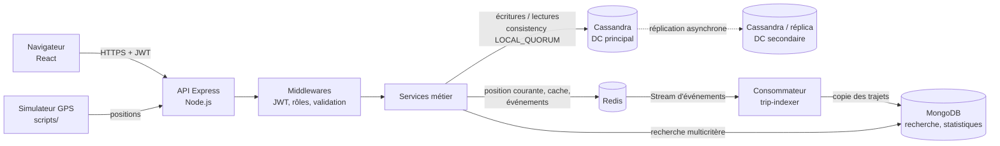

# Architecture

## Schéma global

Principe : Cassandra porte toutes les données métier et en est la seule référence ; Redis porte le temps réel et le cache, MongoDB une copie des trajets pour la recherche et les statistiques (voir [analyse-bdd.md](analyse-bdd.md) et [bdd-secondaire.md](bdd-secondaire.md)).

## Répartition des données

| Donnée | Base | Raison |
|---|---|---|
| Utilisateurs, trajets, réservations, avis | Cassandra | Écritures nombreuses, lecture par clé de partition |
| Positions GPS (historique) | Cassandra | Séries temporelles, forte volumétrie |
| Position courante, véhicules en circulation, cache, tentatives de connexion, jetons révoqués, événements | Redis | Mémoire, TTL, Pub/Sub, `GEO` |
| Copie des trajets pour la recherche, statistiques | MongoDB | Index composés, `2dsphere`, agrégations |

## Justification CAP et partitionnement

- Cassandra est un système AP : disponibilité et tolérance aux partitions réseau sont privilégiées, la cohérence est ajustable par requête (`ONE`, `LOCAL_QUORUM`, `QUORUM`).
- Réservations : lecture et écriture en `LOCAL_QUORUM` pour limiter le risque de surréservation (à compléter, éventuellement avec LWT `IF`).
- Positions GPS : écriture en `ONE`, une position perdue est sans gravité.
- Partitionnement par hachage de la clé de partition : répartition uniforme des données entre les nœuds, pas de point central.
- Redis est AP, MongoDB CP : positions CAP détaillées dans [bdd-secondaire.md](bdd-secondaire.md).

## Réplication et geo-partitioning

- Réplication asynchrone du datacenter principal vers le secondaire : `NetworkTopologyStrategy` avec un facteur de réplication par DC (ex. `{'dc1': 3, 'dc2': 2}`).
- Geo-partitioning : les données d'une région (ex. trajets d'un pays) sont servies par le DC le plus proche, d'où une faible latence ; `CASSANDRA_LOCAL_DC` fait préférer le DC local au driver.
- Tolérance aux partitions réseau : chaque DC reste lisible et inscriptible seul ; la convergence se fait ensuite (hinted handoff, repair).
- Périmètre réel du projet : à décider (cluster Docker à 2 DC simulés, ou un seul nœud documenté avec la cible théorique).

## Flux principaux

1. Connexion : l'API vérifie le mot de passe, émet un JWT avec le rôle.
2. Publication / recherche de trajet : écriture dans les tables de trajets, lecture par (départ, date).
3. Suivi : le simulateur envoie des positions, l'API les écrit (historique dans Cassandra, position courante dans Redis) et les diffuse au front.
